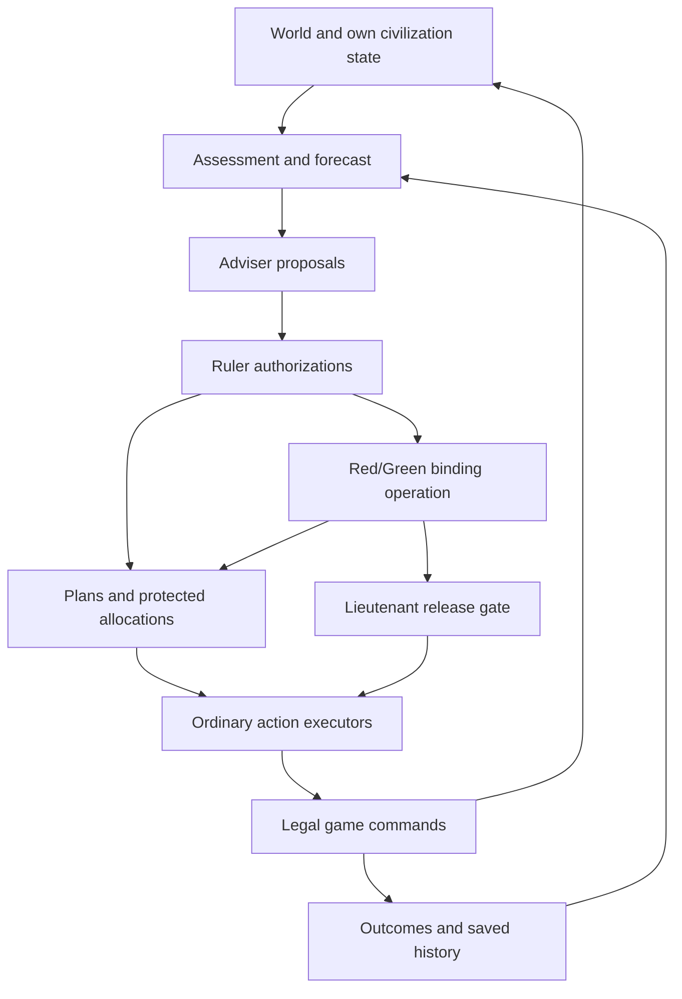
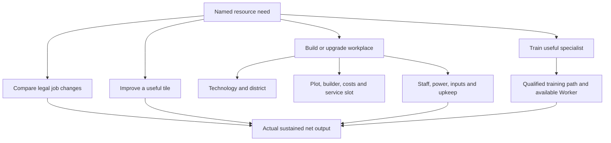
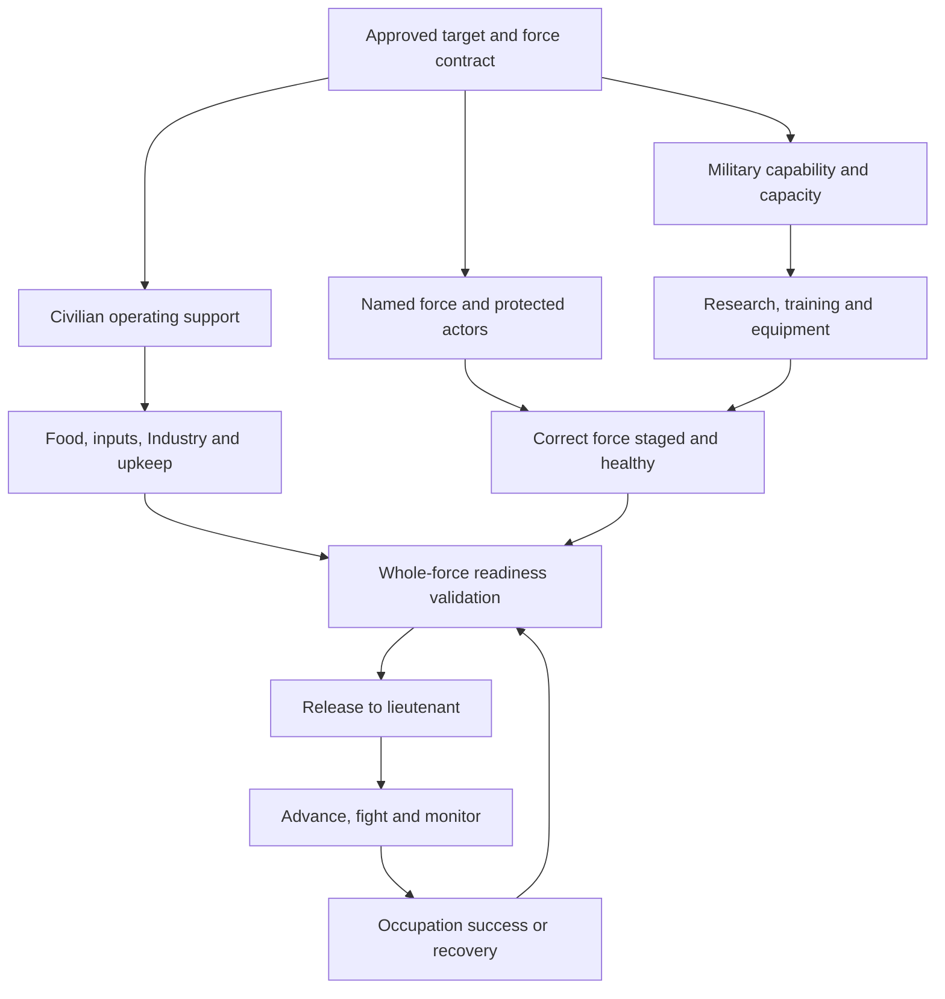

# Alien Planet — programmed AI architecture reference

Snapshot prepared 1 November 2026. Latest documented implementation: **Godot 0.910**, local commit `838460b3d376c40d3d013103956be640422670cc`. Purpose: let a future assistant answer architectural questions, infer likely failure points, and identify the source evidence needed before changing anything. This is a one-off reference, not a new design mandate or an implementation change.

## 0. Read this before making claims

**Source-access limitation:** the previous `/workspace/scratch/c323de99491a/alien-planet-godot` working directory is absent from this session. No Alien Planet source tree was found in the current `/workspace` inventory. This document therefore consolidates implementation reports, the frozen 0.906 inventory/review, the original brief, and the supplied conversation. It is **not a fresh code audit or an exact function-call graph**. “Implemented” below means reported implemented, with the cited historical tests; it does not mean independently reverified in this session. Exact identifiers, current branches, signatures, dispatcher precedence and constants require the matching source.

The development log explicitly says notes are not a source backup. GitHub was last reported at **0.904**; 0.905–0.910 were local and unuploaded. Do not restore 0.904 and mistake it for the architecture described here. Do not claim the unuploaded source has been recovered.

### Fast answers

| Question | Answer at the latest documented boundary |
|---|---|
| Is GPT running inside these players? | No. The players are authored deterministic decision routines operating on game data. |
| Is there only one AI? | No. There are civilization controllers, adviser/plan routines, tactical lieutenants, a separate wildlife controller, and retained older policies. Testing tools are outside these controllers. |
| Can a ruler choose a target and commit a campaign? | Yes, for the mission-specific Red/Green nest operation added in 0.910. |
| Can its economy actually muster and dispatch the contracted force? | Demonstrated in the 0.910 ordinary-economy experiment, with scenario starting troops disclosed. |
| Does it compute an adequate army for any enemy? | No. The binding operation uses a fixed six-unit template. Earlier general force requests were adaptive heuristics but were not an end-to-end feasibility solution. |
| Does a lieutenant execute coordinated combined-arms tactics? | It issues real tactical orders. Joint approach timing, useful fire support, range-aware formations and replacement tactics remain incomplete. |
| Does it learn? | A few saved, bounded thresholds and terrain-caution bands change during a match. It does not discover arbitrary policies or train across matches. |
| Does each adviser have independent authority to spend everything? | No. The ruler/coordinator mediates proposals and allocations; 0.910 adds campaign prerequisite authority. Legal engine checks still apply. |
| Is “supply” ammunition or delivered freight? | No. Here it primarily means forecast Food/Industry upkeep and related economic support. Hard supply-radius limits are disabled. |
| Does a valid replay prove intelligent play? | No. It proves reproducibility under the recorded policy/state. |
| Should we add another mental role to fix a stalled campaign? | First trace authority, dependencies, actor ownership, legal commands and measurable completion through existing roles. |

### Evidence labels used here

- **Implemented/report:** explicitly described as coded in a saved implementation report.
- **Observed:** actually exercised in a retained experiment; conditions and version matter.
- **Historical:** true of an earlier version, potentially superseded.
- **Intended:** requested behaviour, broader than what has been demonstrated.
- **Inference:** an architectural consequence drawn from the evidence, not a newly inspected code fact.
- **Unverified:** requires recovered source, trace or a new focused test.

Conceptual operation names below are descriptive labels, not invented function names. Only the source-anchor table and documented command names identify code symbols/files. Dependency diagrams describe responsibility and prerequisites; arrows do not assert literal calls.

## 1. Source ledger and reading order

| ID | Source and location | What to use it for | Limits |
|---|---|---|---|
| S1 | [Development log](https://chatgpt.com/library?file_id=libfile_45168cb0036081919cff15db493efd5f&account_id=personal), version 32 read for this snapshot | Version chronology, requested work, implementation summaries, uploads, later corrections | Historical record; not source code |
| S2 | [0.910 binding-operation report](https://chatgpt.com/library?file_id=libfile_79b2ba57a0e0819197b172fe67f5b54e&account_id=personal) | Latest operation authority, force contract, release/recovery, controlled results and limitations | Mission-specific implementation; no general dependency solver |
| S3 | [0.909 terrain rules](https://chatgpt.com/library?file_id=libfile_6b55ac41e0e48191b775544065630cbb&account_id=personal) | Green scenario, precise terrain learner, tactical defaults, separate faction memories | Some military release/supply policies superseded by S2 |
| S4 | [0.908 tactical notebook](https://chatgpt.com/library?file_id=libfile_3dcf8d6003e08191929a986204033539&account_id=personal) | Lieutenant mechanism, action order, narrow adaptation, hypotheses and failed runs | Two-player experiment, before Green/binding operations |
| S5 | [0.906 full inventory](https://chatgpt.com/library?file_id=libfile_29b1b09192d48191a0ebd84127cf7788&account_id=personal) | Exact earlier content/rule inventory, code boundaries, initial coordinator policies | Frozen; not a current 0.910 controller specification |
| S6 | [0.906 action coverage review](https://chatgpt.com/library?file_id=libfile_4dfcba6217e481919a8785738ef446e8&account_id=personal) | Legal possibilities versus AI reachability, dormant mechanics, evidence discipline | Later stock/staffing/campaign fixes must supersede old defects |
| S7 | [Original development brief](https://chatgpt.com/library?file_id=libfile_aefa535cbafc81919a77d7b5075c8536&account_id=personal) | Architectural intent and ten originating ideas | Initial resource names, growth, supply, rover and demo restrictions are historical |
| S8 | User/assistant conversation supplied with this request | Ruler/adviser/lieutenant intent; earlier code-analysis findings and proposed solution | Earlier explanations can be overtaken by subsequently implemented work |

For a campaign question read S2, then S3/S4, then S1's matching batch. For basic mechanics use S5/S6, then check later overrides. For user intent use S8 and S7. Never treat a proposed next test in these reports as completed work.

## 2. What the user is building and what “thinking” means

The user wants a small but extensible architectural game shell: geography, persistent people, workplaces, production, technology, settlement growth and military action should connect and produce interesting behaviour. More content and numerical tweaks are expected later. The present balance and roster are provisional; forcing every object to be used or constructing a huge generic framework is not the goal.

The original ten ideas were hex geography; five/six resources; movable population; population working buildings; persistent population types; layered terrain; districts; differentiated supply reach; linked technical/social progression; and grounded capability development. People connect economy and map: the same person can work, train, mobilise, move and rejoin. A building creates capacity; labour and inputs deliver output. Some initial choices have since changed, especially active supply range and resource names.

The later AI requests add the following intended chain:

1. A ruler knows its doctrine and civilization's current means, selects goals and makes commitments.
2. Advisers diagnose domains and propose useful programmes with reasons.
3. Governors develop settlements according to persistent roles.
4. A general proposes and sustains an objective-specific force while protecting home.
5. A lieutenant receives target and personnel, acts tactically, and retains useful encounter evidence.
6. Review detects failure and changes the preparation/execution plan without constant staffing reversals.

In this implementation “knows” means a routine reads structured state. “Wants” means an authored objective/weight/charter. “Opinion” is a scored proposal with explanatory fields. “Decision” is selection/authorization of a plan or legal order. “Learning” is the particular counter-driven updates in section 10. None implies natural-language comprehension or human reasoning.

## 3. Inventory of coded decision systems

| System | Reads | Produces / changes | Scope and principal limit |
|---|---|---|---|
| Civilization assessment | Own stocks, net flows, population/jobs/projects/equipment; shared geography/threats | Forecasts, shortages, candidates and summaries | Fully revealed map; bounded forecasts, not adversarial future simulation |
| Persistent coordinator | Assessment, active plans, resource/person allocations | Goal priorities, selected ordinary actions, status/history | Explicit policy branches and finite attention budget |
| Ruler / council | Doctrine, adviser proposals, existing commitments | Bounded authorized portfolio, deferrals, allocations | Soft commitments alone did not establish a binding cross-domain campaign |
| Scientist adviser | Capability needs/doctrine, prerequisites and current infrastructure/people | Technology/specialist programme | Cannot infer useful policy from arbitrary new content text |
| City planner | Shared survey, claims, settlement roles, target geography | Site/road proposals and preparation work | Proposed location/corridor is not a completed, staffed, protected support base |
| Settlement governors | Persistent town purpose, jobs, local people/facilities, economy | Staffing, training, workplaces and operating commitments | Local choices can conflict; no globally optimal labour allocation |
| General | Home threats, troops/equipment, military capacity, support economy, nest | Defence allocations, army requests, equipment/refit/support | Earlier desired counts contradicted recruitment ceilings; latest charter fixes a particular contract rather than solving all army design |
| Tactical lieutenant | Allocated force/target, health, legal attacks, terrain, comrades, supply authorization | Shoot, charge, retreat, advance; tactical occurrences/counters | Sequential local decisions, weak joint timing/support estimates |
| Terrain memory updater | Incoming combat-location events and terrain classes | Per-faction counters and caution bands | Correlation-based caution, not causal terrain analysis |
| Binding nest supervisor, Red/Green | Charter, dependency progress, staff/gear/health/staging/supply | Prerequisite authority, protection, release and recovery | Specific 0.910 nest mission; fixed four-rifle/two-flamer contract |
| Wildlife ecology/controller | Nest stocks/caps, local geography, nearby people, animal health | Harvest/spread/birth/upkeep, pursuit/spit/melee | Local pests, not a human civilization or another adviser council |
| Earlier civilization/expansion agents | Earlier policy inputs | Historical choices | Retained source implementations were reported; not the active 0.906 dispatcher. Verify current reachability after source recovery. |
| Human UI/session | Selections, settings, commands | Manual orders, AI stepping and configuration | Human choices can override planner reservations; UI does not constitute another autonomous mind |
| Experiment/replay tools | Initial conditions, policy, command stream and saved states | Evidence, replay comparison, maps and checks | Outside the in-world AI; supplying armies is an explicit fixture intervention |

Blue, Red and Green are separate civilization states/controllers. Stocks, technology, projects, people, council records and learned caution are private. They share a world and can share a known target; they do not have a common commander, supply pool or assault schedule. Wildlife has its own tick/state. The assistant outside the game writes code and analyses results; it is not an in-world adviser reading this document at runtime.

## 4. Responsibility and execution graphs

### 4.1 Control, authority and feedback

This is a logical graph. The precise relative dispatch order of all adviser, operation, emergency and lieutenant paths is unverified without 0.910 source. The reports establish that tactical attention was moved before further general preparation, that binding release gates offensive advance, and that immediate fire/retreat remained available in the tactical design.

Authority is not legality: a charter can authorize spending but cannot make an illegal job, equipment withdrawal, construction plot or attack valid. Conversely, a legal engine action may have no autonomous caller.

### 4.2 Three dependencies that must not be conflated

| Dependency | Example | What it establishes |
|---|---|---|
| Call/dispatch | Session invokes policy, which selects an executor | Whether a coded behaviour can run at all |
| Game prerequisite | Technology/building/person/stock conditions for an order | Whether the order is legal now |
| Plan dependency / authority | Workshop investment serves an approved expedition | Why it should happen, who owns it, and whether its budget/person may be used |

Old failures often had a legal action helper and a sensible goal, but no binding link across the last row. A dependency diagram does not prove the caller exists; a helper's existence does not prove the dispatcher selects it.

### 4.3 Executable action path

Assessment → candidate goal → scored/authorized plan → chosen actor and target → reserve/loan/spend checks → ordinary command → engine validation → accepted transition or explicit rejection → recorded outcome → subsequent review.

For a stalled action inspect each transition. A displayed proposal can be stale. A “ready” label is not authoritative if the release gate recomputes readiness. An issued movement order is not proof of arrival. A constructed workplace is not proof of staffed output.

## 5. Information, evaluation, attention and persistence

### 5.1 Information actually available

The controller has a fully revealed map and own actual ledger, jobs, projects, people, gear, claims and technology. Shared survey data includes local terrain, features/layers, potential yields, structures, people and wildlife. The survey's yield total is potential extraction, not output already staffed. No fog-of-war scouting discovery or modeled rival strategic intentions is reported.

The 0.906 assessment implements a five-economic-turn forecast with current orders/projects and the ordinary economy. It excludes future enemy actions and future policy choices. It can evaluate individual staffing/departure changes and exact present melee odds. This is not a branching strategic game search. Later campaign provisioning adds a longer mission budget; that must not be confused with a 24-turn tactical simulation.

### 5.2 Goal selection and service

0.906 creates survival, income, defence, settling, terrain and offence plans. Income evaluates named Food, Minerals, Industry, Energy, Science or Culture demand. Default net targets were Food 2, Minerals 2, Industry 3, Energy 2, Science 2, Culture 2; Food demand also scaled with population and founder labour withdrawal. These are **historical baseline constants**, not a verified full table of 0.910 weights.

The coordinator originally allowed up to twelve steps per civilization turn, including review/status bookkeeping. The lieutenant notebook explicitly retained that budget. A ready plan can receive little useful service if other paths consume it. Exact 0.910 accounting must be checked in source. “Ensure categories exist” does not mean each gets a quota of meaningful orders every turn.

In 0.907, doctrines and scored adviser proposals produce a bounded portfolio. Blue favours technology/specialization; Red favours nest removal. Settlement roles persist. Operating jobs have six-turn terms, including within one adviser; emergencies can override. Ruler commitments receive a six-turn preference rather than absolute immutability. Neither is a universal prohibition on changing jobs.

### 5.3 What survives a turn/save

Reported saved data includes physical game state and RNG; plans with IDs, category/status/stage, priority/reasons/timestamps, actor/budget allocations, target and blockers; doctrine/council/governor state; job terms and temporary construction loans; lieutenant target/force/phase/counters; terrain memories; and 0.910 operation charter/progress/release/recovery.

Earlier limits include a 100-entry AI history and a 128-event tactical tail. Full recordings are separate and have their own cap/drop reporting. Verify current limits before claiming a complete event history. Stable ordering matters: earlier JSON load changed town/job order and later adviser explanations until canonical ordering was repaired. Replay compared private AI state as well as the visible result.

The reports describe schema 14/world 4 with optional validated additions through 0.910 and recorder versions 7, 8, 9 and 10 across the respective batches. A common schema number does not make old executable policy identical to new policy. Loading an old save was specifically not meant to add Green or free troops silently.

## 6. Economic, research and governor dependency trees

### 6.1 Improve a chosen income stream

This graph lists dependency types, not a promise that every branch is compared optimally. The income executor maps selected resources to authored jobs, improvements/workplaces and specialist paths. It supports recursive explicit prerequisites; the 0.906 helper depth bound was eight. It does not infer arbitrary production chains from content descriptions.

Resource accounting uses **Food, Minerals, Industry, Energy, Science and Culture**. Industry is construction/manufacturing spending capacity, not a synonym for Minerals. Minerals and Energy can be operating inputs. Staff absence during training, building or mobilization changes income. Withdrawn food workers and disabled power/input chains can invalidate an apparently affordable plan.

Governors add persistent specialization and local programmes, but cannot assume desired output exists after purchasing an unlock. The useful chain is capability → capacity → available labour → assignment → power/inputs → production → net after upkeep. Each edge is a separate possible blocker.

### 6.2 Technology and training

The available technology inventory at 0.906 has twenty technologies across Biology, Industry, Military, Exploration/Research and Social. Conditions include other technologies, buildings, required professions and retained resources. Training takes a Worker out of production and uses a timed service. Technology acquisition does not automatically create its specialists or workplaces. At that boundary a prerequisite checked existence, not necessarily an actively staffed/powered facility; do not silently strengthen it when explaining strategy.

The scientist gained a capability programme in 0.907, beyond simply reacting to the primary income target. Actual blue specialization/research increased. Nevertheless, there is no demonstrated optimizer comparing every technology's long-term empire value, and no natural-language conversion from a new technology description into goals.

### 6.3 Labour commitments and known conflicts

The same person may be wanted as food worker, specialist, builder, founder, trainee or Soldier. One persistent identity prevents duplication but does not itself resolve priorities. Allocations and operating terms protect jobs; a temporary construction loan records the old job and attempts restoration. Restoration can fail if that job disappears or circumstances change; it is not proof of seamless workforce planning.

0.906 terrain work repeatedly withdrew red's Generator workers. 0.907 added terms/loans and fixed equivalent-slot and same-adviser bouncing. Its final run had no same-turn A→B→A cycles. **0.910 still had repeated cross-turn mobilize/dock churn.** These are different failure modes; the old repair does not establish universally stable staffing.

A baseline policy may stop at satisfied targets while useful capacity is idle. In 0.906 broad settlement startup income reduced pressure for specialist workplaces. Thus underuse can arise from low demand/incentives as well as missing policy. Do not prescribe extra training solely because an unused profession exists.

## 7. Settling, terrain work, roads and defence dependencies

### 7.1 Settling

Choose surveyed site → ensure spacing and legal access → reserve suitable founder and optional escort → obtain builder gear → test lost workplace output/field upkeep/home safety → mobilize → traverse/clear → found empty site → join a real person → staff and maintain it.

Town centers require at least **two intervening hexes**, i.e. hex distance at least three. A new site starts with a one-hex claim and no free population. Empty settlements retain grey registered claims; a founded marker is not an active economy. Connected Culture purchases may extend access to radius three. Roads, terrain and claims affect which work/travel is possible. Exact current cost constants should be taken from source, not reconstructed from remembered prompts.

The original coordinator handled one founder/destination at a time, with fixed danger exclusions/backoff. City-planner roles later valued forward sites toward the nest. That establishes a selection preference, not successful protection of a remote outpost. In 0.908 an actual forward settlement became empty.

### 7.2 Map manipulation and roads

Implemented actions include clearing removable layers, improvements, districts, compatible workplaces/upgrades, and connected tile access purchases. Terrain helpers select an authored subset of improvements according to current needs. Fungal Garden, Survey Beacon, Trade Post and Watchtower lacked normal selection branches in the frozen 0.906 review; no later source evidence here establishes general new policies for all four.

Road proposal → useful endpoints/corridor → legal plots/access → available builder/equipment → clearing/construction service/cost → actual completed road → reduced travel cost. A road plan can be unserved even while unrelated terrain helpers build road tiles. Recorded 0.907 road actions did not belong to its dedicated road proposal; 0.908 did execute dedicated road work.

Roads accelerate movement, including fractional/partly paid edges; they do not carry an ammunition or goods resupply network. Forward towns provide existing settlement services such as healing/refit, conditional on actual staffing/support and legal actions. Freight, depots and supply convoys cannot be assumed from the word “road.”

### 7.3 Home defence

Threat assessment → select exposed home/frontier interests → reserve home personnel → train/equip/refit if needed → position and issue legal attacks/retreat → review civilian losses and response reach.

Home guards were allocated before offensive troops. There is no automatic interception or Soldier shielding in the documented combat engine: a predator can attack a co-located civilian. Therefore “a guard is present” does not prove civilian safety. Likewise a coarse danger mask is not a complete enemy move-plus-fire reach calculation. Heavy predators' two-tile spit envelope was specifically underestimated by the movement heuristic through 0.910.

## 8. Binding nest operation — latest documented military chain

### 8.1 Contract and authority

0.910 gives **Red and Green** persistent nest-cleansing charters. Blue retains its previous policy. A charter records a particular target, assembly hub, staging hexes, fixed required force, protected people, preparation tasks, release conditions and recovery state. The known nest target in the preceding campaign is hex **18,12**.

The approved expedition is **four rifle Soldiers plus two flamer Soldiers**, with a **separate home guard and civilian support**. Six is an experimental contract, not an estimated sufficient force against the current enemy. Civilian-support requirements can rise when domestic staffing blocks progress.

Supporting research, economic assignments, buildings, training, equipment and growth may serve the approved operation across adviser boundaries; discretionary competing work can be deferred. This resolves an important authority gap. It does not introduce a general task-graph solver or optimal production scheduling. Existing ordinary game commands still perform the work at ordinary costs.

### 8.2 Prerequisite and release graph

The loop back denotes remustering after a recoverable failure, not revalidating the entire original 24-turn budget every turn. Completion is an actual game-state condition, not the presence of an operation title.

### 8.3 Phase requirements and blockers

| Conceptual phase | Conditions / activity | Failure to distinguish |
|---|---|---|
| Approve | Target, composition and authority persisted | A merely scored general proposal is weaker than a charter |
| Prepare economy/capability | Civilian support, prerequisites, capacity, training/equipment and stocks | Technology or banked resources alone are insufficient |
| Domestic preparation | Personnel may dock and work temporarily | Domestic production must be cleared before release |
| Assemble | Correct six offensive loadouts, separate home guard, staging and health | Headcount alone does not prove composition or co-presence |
| Provision/release | Whole-force readiness recomputed; initial 24-turn supply approval | Forging a saved “ready” label cannot bypass checks |
| Execute | Lieutenant handles tactical orders after authorized release | Readiness proves dispatchability, not battlefield adequacy |
| Recover/remuster | Attrition or insufficient support triggers recovery | Rebuilding below an old progress high-water mark may be misclassified as stalled |
| Complete | Eligible Soldier occupies/crosses the undefended nest tile and it becomes burned | Animal kills or a visual flame are not completion |

After deployment, approved supply horizon decreases with elapsed time, with a four-turn floor. The report specifically fixes the error of recalling an expedition simply because it consumed its approved budget. Exact health/provision formulas and event order still need 0.910 source verification.

### 8.4 What changed from the earlier broken chain

| Earlier failure | 0.910 reported resolution | Remaining limit |
|---|---|---|
| Green wanted eight offensive troops while a population rule allowed two Soldiers total | Reconciled troop ceiling with support population for the operation | No general force-sizing optimizer |
| Red's completed guard protected all five available Industry | Removed conflicting completed-guard escrow | Check other reservation interactions before claiming none remain |
| Funding reservations vetoed approved prerequisites | Operation authorizes its prerequisites | Mission-specific authority, not arbitrary dependency resolution |
| Lieutenant could depart with two regardless of general request | Whole-force charter release gate | Six-unit composition may still be inadequate |
| Deployed Soldiers could remain domestic workers | Clear military domestic jobs before release | Commissioning/docking churn persists |
| Constant fresh long provisioning requirement could trigger recall | Decreasing approved horizon | Tactical attrition still breaks waves |

**Inference:** the original “no binding decision exists” diagnosis is now historical. The current documented problem is delivery efficiency and effective execution of a specific binding contract, plus lack of general force estimation.

## 9. Tactical execution and actual combat dependencies

The general supplies/allocates; the lieutenant receives force and target. Tactical attention runs ahead of more recruitment/construction. Starting with 0.908, deployed troops can fire, charge, retreat or make short movement orders while preparation continues. 0.910 gates offensive advance until release.

### 9.1 Reported tactical rules

| Decision | Authored mechanism | Limitation |
|---|---|---|
| Ranged target | Reachable enemies sorted by lower HP, then stable ID | Not threat-value ranking or optimal weapon assignment |
| Charge | Exact duel odds initially at least 60%, plus target HP ≤45 or supported flamer | Nearby support within two includes attacker; does not prove useful assistance |
| Retreat | Initially below 55 HP, toward own settlement | Greedy escape can fail; retreat count is not rescue count |
| Advance | One neighbouring step scored for progress, cover, comrades, threat, cost/crowding | Not a synchronized whole-force route/timetable |
| Formation | Prefer at most three armed mobile trained Soldiers per tile; passengers excluded | Soft sequential AI limit; emergency retreat exception; engine stacking unchanged |
| Supply | Earlier campaign uses short Food/Industry readiness; charter adds whole-force horizon | Exact active path depends on faction, version and operation phase |
| Victory action | Eligible Soldier enters undefended nest | Must connect clearing defenders to final occupation |

Two factions attacking the same target do not coordinate arrivals, targets or replacement schedules. “Two comrades nearby” can include a wounded, exhausted, out-of-range or otherwise unusable comrade. Presence, legal support and scheduled support are distinct quantities.

### 9.2 Engine facts needed to interpret tactical behaviour

The frozen 0.906 inventory describes 100-HP people/animals, stochastic melee to death with exact current win-odds calculation, and non-retaliated ranged packets. Rifle Soldiers shoot at range two at half base strength. Flamer Soldiers shoot at range one with double offensive power against animals. Heavy predators spit at range two. Attacks cost movement, are limited to one per person/world turn, and clear route/progress. Quiet units heal, faster at own towns/nest. Hills, forest and certain layers grant defence. Rivers affect movement but have no combat modifier in that inventory.

The later experiments explicitly kept combat/wildlife balance unchanged, so these rules explain reported outcomes; source recovery should still confirm exact numbers before new code work. No line-of-sight, ammunition, suppression, experience, interception or automatic screening is reported. A flamer suit does not acquire extra armour merely from its name or picture.

The nest's stored HP is not a directly attackable building-health battle. Disabling it stops its worker/birth/upkeep activity; existing predators/mat remain. Predator kills, biomass shortage deaths and direct human attack kills are different event categories.

## 10. Adaptation: exact meaning and dependency tree

### 10.1 Casualty thresholds

S4/S3 report these bounded updates:

| Evidence trigger | Policy update |
|---|---|
| Two observed field-Soldier deaths | Retreat HP 55 → 70 |
| Two deaths with fewer than two nearby Soldiers | Minimum support 1 → 2 |
| A charge kills its attacker | Required charge win odds 60% → 78% |

These are authored responses within one saved match. A fresh match starts at defaults. No evidence here establishes cross-match learning, tactical program synthesis or an independently learned causal model.

### 10.2 Terrain memory

Incoming enemy-initiated combat event → actual combat tile → class by base terrain / hills-or-flat / forest-or-clear → faction-private hit/damage/death counters → threshold → caution band → next-step score penalty.

At least three incoming hits and 60 total HP damage yields band 1; with a recorded death and the threshold satisfied, band 2. Movement score penalty is 2.5 per band. It changes preference, never underlying movement costs or combat defence. An unflagged class means insufficient evidence, not safety. Outgoing attacks and movement contexts are also recorded, but the terrain caution's damage attribution uses actual incoming-combat locations rather than later positions.

0.909 observations: Red fungal/hills/clear band 2; Green desert/hills/clear band 2 and fungal/hills/clear band 1. Both raised retreat HP to 70. Neither changed charge/support thresholds in that run. A fixture established that memory can change next-step choice. The live campaign did not establish that this change improved survival or victory.

**Inference:** losing soldiers on hills near predators does not imply the hill defence bonus is harmful. Enemy concentration, range, HP, equipment and route are confounders. Increasing caution can even prevent necessary closing range. Evaluate matched saved encounters before endorsing a causal lesson.

## 11. Wildlife controller as a separate dependency system

Nest stocks/caps and terrain opportunities → larvae harvest/spread → biomass/Minerals availability → upkeep and birth choice → local predator population → detection/pursuit/spit/melee → human casualties and tactical feedback.

Documented roster: Mandible larvae, ordinary Hookrunners and heavier Carapace predators. Per nest, three larvae maximum and **six predators total**, ordinary and armored sharing that cap. “Six predators, six armored” means six predators all armored, not twelve. Births replace missing larvae first, otherwise favour heavy predators if Minerals permit. Short biomass can damage/kill animals. Predators pursue nearby non-cargo people with deterministic tie ordering plus the engine's combat RNG.

Wildlife's local policy can be consistent while human campaign policy is inconsistent. That does not by itself prove wildlife numerical strength is balanced, nor that adding human adviser layers increases practical military capability.

## 12. History: requests, implementation and evidence

| Stage | Requested/intended | Implemented and observed | What it did not establish |
|---|---|---|---|
| Initial brief | Small integrated economic/map shell | Movable identity, tile/building work, capabilities and construction | A complete 4X or intelligent ruler |
| 0.902–0.905 | Separate Red, ecology/combat, survey and expansion | Local action policies, shared survey, founding/access/grey claims | Coordinated economic survival; 0.905 Red lost all population |
| 0.906 | Survive/expand/income with persistent plans and domain mechanisms | Reservations, forecasts, prerequisites, planning UI; both civilizations grew across 200 rounds | Adaptive offensive sizing or a binding campaign |
| 0.907 | Ruler doctrine and adviser choir, stable specialized governors | Distinct doctrines/professions/workplaces, terms/loans; no same-turn reversal cycles | Tactical attention or complete campaign delivery |
| 0.908 | Lieutenants, target/task force, roads/outposts, tactical occurrences | Real firing/charges/retreat, bounded adaptation; forward outpost/roads | Sustainable force preparation or effective coordinated assault |
| 0.909 | Eastern Green and supplied Red/Green starting troops | Both approached/fought; separate terrain memories | Replacing lost force; no nest kill |
| Principle discussion | Can leader/general bind the chain? | Diagnosis of ceiling/reservation/readiness contradictions | At that point the proposed operation record was not yet implemented |
| 0.910 | Implement binding operation and test preparation/execution | Ordinary-economy six-unit forces mustered and released; explicit supplied early fixture won | General solver, adaptive adequate force, mature-world victory or stable commissioning |
| This reference | Factual architecture before more fixes | Consolidates evidence and open verification needs | No new gameplay, tests, source recovery or upload |

0.907 check-count correction: the final development log gives **2,043**, whereas a supplied interim commentary said 2,042. Use the final log for that batch and retain the discrepancy as provenance. Counts are historical reported validations, not tests rerun today.

## 13. Experiment ledger and defensible conclusions

| Version / experiment | Material conditions | Outcome | Supported conclusion |
|---|---|---|---|
| 0.906, seed 731, 200 rounds | Two controllers, normal run | Blue 81 people/10 sites, Red 88/11; nest survived; 1,992 checks, 3,776-command replay | Growth/basic economy works better; advanced use and offence weak |
| 0.907, seed 731, 200 rounds | Ruler/advisers | Blue 16 techs, Red 13; deaths 0/25/2 animals; nest survived; 4,186-command replay | Doctrine affects action mix; preparation did not yield effective warfare |
| 0.908 final, 200 rounds | Tactical lieutenants | Blue never departed; Red 9 shots/no charges; empty forward outpost; 3,758-command replay | Tactical caller works but strategic and tactical adequacy incomplete |
| 0.909, seed 731, 200 rounds | Red/Green each five civilian starters plus four extra trained troops, three rifles/one flamer | Each lost 3; 4 animal deaths; nest survived; 3,133 checks, 5,421-command replay | Supplied starting forces approach/fight/retain terrain memories; replacements fail |
| 0.910 preparation-only | Normal scenario, departure deliberately held | First full readiness Red 104/Green 141 | Contract achievable; not continuous readiness through round 200 |
| 0.910 main, 200 rounds | Normal Red/Green campaign scenario includes four starting field Soldiers each; missing force/capacity/support earned | Releases Red 104, Green 141 and 200; deaths Blue 0/Red 4/Green 4/animals 4; nest survives | Binding preparation/release achieved; not a from-zero army test or military victory |
| 0.910 early supplied | Complete forces plus 2,000 Food and 300 each Industry/Energy/Minerals | Nest disabled world turn 21; no human deaths/9 animals | Engine and policy can complete occupation under these conditions |
| 0.910 mature supplied | Restored complete force at world 142, large grants, run through 201 | Nest survives; additional deaths Red 8/Green 4/animals 3 | Stocks alone do not solve the mature encounter; attrition breaks waves |

0.910 reports 3,424 checks across sixteen suites and exact 5,215-command main replay, including all three private AI states, zero dropped commands. Other final-policy replays: preparation 5,027; early supplied 2,990; mature supplied 1,390; earned continuation 2,053.

In the main 0.910 run Red made 57 mobilisations/56 docks and Green 19/13. Red produced 27 rifle ranged attacks and one flamer melee; Green eight rifle ranged attacks. No flamer ranged attacks occurred in the ordinary or mature supplied campaign. These counts establish churn and unused ranged capability, not the exact cause of every lost encounter. The early/mature supplied cases differ in timing, enemies and histories and are not a single-variable comparison.

## 14. Missing capabilities, dormant mechanics and unresolved intent

| Area | Latest evidenced state | Do not claim |
|---|---|---|
| General planning | Explicit heuristic goals and a specific binding nest supervisor | Arbitrary goal decomposition/feasibility solving |
| Army design | Fixed latest charter plus earlier adaptive request heuristics | Reliable estimate of adequate force versus mature nest/replacements |
| Tactical cooperation | Sequential local movement/fire, soft crowding and proximity support | Joint volleys, synchronized arrival, protected retreat or faction cooperation |
| Staffing | Operating terms/loans and several oscillation fixes | No cross-turn commissioning churn |
| Enemy reach | Correct engine attack rules, coarse movement danger estimate | Correct heavy move-plus-two-tile threat envelope |
| Logistics | Forecast upkeep, towns/roads, equipment stocks | Ammunition/fuel/material freight/convoy network |
| Exploration | Revealed map and survey | Fog discovery and a distinct useful Explorer scouting model |
| Trade/medicine/transport | Engine actions/content exist for some uses; 0.906 lacked dedicated visitor/cargo/Medic/retraining missions | Latest autonomous use without a later source/trace check |
| Human war | No documented PvP/capture/diplomacy mechanism | AI should invade/capture another civilization using existing combat |
| New content | Definitions plus legal action/UI can be extended | Automatic autonomous use simply because an item is added |
| Learning | Bounded match-local caution/threshold changes | Learning code, causal tactics or persistent intelligence from these reports |

Other frozen dormant effects include Field Coordination's disabled range benefit, Explorer-specific advantage, stronger suit armour, Watchtower defence/sight, and xenomass combat advantage. Unless later source contradicts the inventory, names do not supply these effects. Housing/happiness, seasons/weather, resource depletion, naval/air travel and extensive terraforming are not reported implemented. They are not missing AI branches for existing mechanics.

## 15. Source recovery and function-reference map

The following file basenames/boundaries are documented in S5, not inspected today. Resolve actual paths with `rg --files`, read applicable `AGENTS.md`, and verify dispatch before drawing a literal call tree. Do not guess new adviser/operation filenames.

| Anchor | Reported responsibility | Questions to trace in recovered 0.910 source |
|---|---|---|
| `game_rules.gd`, data JSON | Legal orders, economy, people/projects, validation/migration | What makes an action legal? What effect is real rather than text? |
| `civilization_session.gd`, `claim_map.gd` | Faction isolation, shared world/access, dispatch/recording | Which controller runs for each faction/save? What is turn/ecology order? |
| `ai_assessment`, `ai_coordinator`, `ai_plan_actions` | Evaluation, saved goals/allocations, ordinary order selection | Who calls each candidate? Which gate/priority prevents execution? |
| `civilization_agent`, `expansion_agent` | Earlier policies retained at 0.906 | Are any still reachable, test-only or obsolete? |
| `tile_survey`, `territory_atlas` | Shared evaluator data and schematic rendering | Potential versus actual yield? Map drawn from which save? |
| `combat_rules.gd`, `xeno_ecology.gd` | Combat math, health, local wildlife and nest occupation | Range/odds/threat mismatch? Birth/death causes? |
| `map_generator.gd`, `terrain_layers.gd` | Geography/deposits/layers | Which terrain facts affect movement, combat, extraction? |
| `main`, `hex_map`, `world_map`, `world_batch` | UI and interchangeable presentation | Display stale state or selected faction? AI does not read pixels. |
| `tests/`, `reports/0907`–`reports/0910`, `docs/Batch_0910_Notes.md` | Fixtures, traces, version notes | Which policy/hash/setup produced the cited evidence? |

Documented ordinary command families include `assign`, `develop`, `train`, `clearSpecialty`, `manufacture`, `equip`, `mobilise`, `move`/`queueMove`, `cancelMove`, `board`, `unload`, `join`, `visit`, `cleanse`, `build`, `improve`, `upgrade`, `foundSettlement`, `buyTile`, `attackXeno`, and `endTurn`. Session/planner/configuration operations include `aiReview`, `aiPlanStatus`, `xenoTick`, `setAIFocus`, `setAllegianceColor`, and legacy settlement-plan helpers. These are command names from the frozen inventory, not a verified exhaustive 0.910 command schema.

For exact function documentation after recovery, record **symbol, file, caller(s), input/state, preconditions, output/command, mutation owner, failure reason, saved fields, test/trace evidence**. Label a statically possible caller separately from a path observed in play. Derive real call/dependency trees from these records. Until then this reference supports high-level reasoning only.

## 16. Diagnostic index for a future assistant

| Symptom/question | Inspect first | Distinguish / likely inference |
|---|---|---|
| “Why did nothing happen?” | Dispatcher, available step budget, authorized plan, exact blocker | No caller; no demand; unserved proposal; legal rejection; real infeasibility |
| “Why isn't a building used?” | Staffing, input/power, output target, governor role and training path | Existing capacity versus realized output; incentive versus policy gap |
| “Why cannot it afford this?” | Stocks, net flows, normal upkeep, reservation owner and operation prerequisite membership | Actual scarcity versus self-imposed budget veto |
| “Why is general asking but not recruiting?” | Force contract, total troop ceiling, civilian support, training service and actor eligibility | Desired count alone does not authorize feasible recruitment |
| “Why is it ready but won't depart?” | Actual composition, home guard, cleared domestic jobs, staging/health, supply release gate | Display/certificate versus present readiness |
| “Why does it dock and mobilize repeatedly?” | Domestic preparation/commission phase transitions, job protection and recovery reasons | Same-turn slot reversal was fixed earlier; this is a separate temporal conflict |
| “Why no flamer fire?” | Equipped actor, legal adjacent target, movement/attack availability, target selection, retreat/advance order | Old stock-at-capacity selection bug was fixed in 0.907; range/timing may be the current issue |
| “Why did a guarded civilian die?” | Actual target selection, attack range and legal guard action | No automatic interception/shielding exists |
| “Did it learn hills are bad?” | Terrain event attribution, exposure/sample, enemy/range/HP context, score changes | Bounded association, not causal terrain disadvantage |
| “Did the charter solve the game?” | Separate preparation, release, sustained battle and nest occupation | It solves a particular coordination gap, not tactical adequacy |
| “Does a win validate balance?” | Grants, initial force, world age/seed, unchanged controls, matched comparisons | One supplied early win is a mechanism demonstration |
| “Can this new content be used?” | Definition → legal effect → UI/art → goal/evaluator → executor/dependencies → success/skip evidence | Missing any link can leave content legal but autonomously unreachable |
| “Is this current?” | Commit/version/faction/phase and source ledger | Old coordinator numbers and failure diagnoses can be superseded |

### Safe conclusions already supported

The user-specified ruler/adviser/general/lieutenant division is programmatically workable. Doctrines changed behaviour, and a mission-specific binding operation actually delivered its contracted force. Increasing organizational layers alone did not make it tactically effective. Current evidence supports investigating force adequacy, commissioning stability and joint approach/fire/retreat handling; it does not establish which single change would produce victory.

### Unanswered questions to carry into the next source review

1. What are the exact 0.910 dispatcher call graph and emergency/operation/lieutenant precedence, including command-budget consumption?
2. Which current blocker causes each mobilize/dock cycle, and does each phase own a stable staffing configuration?
3. How are staging hexes and force members selected and reselected after losses? Can old progress certificates hide a broken current force?
4. Which prerequisites use explicit operation authority and which still use ordinary reservations or civilian limits?
5. Does every potential flamer shot receive consideration before movement/retreat? How often is adjacent range legally reachable with supported retreat?
6. What enemy actions are reachable next turn, particularly heavy movement plus spit, and how does the heuristic differ?
7. Which old code paths remain active for Blue, old saves, home guards and escorts while Red/Green use a charter?
8. Which presently ignored legal mechanics have real demand under current rules, versus merely attractive labels?

These are review questions, not instructions to apply fixes. The requested deliverable is this factual reference. Gameplay and source upload status are unchanged.